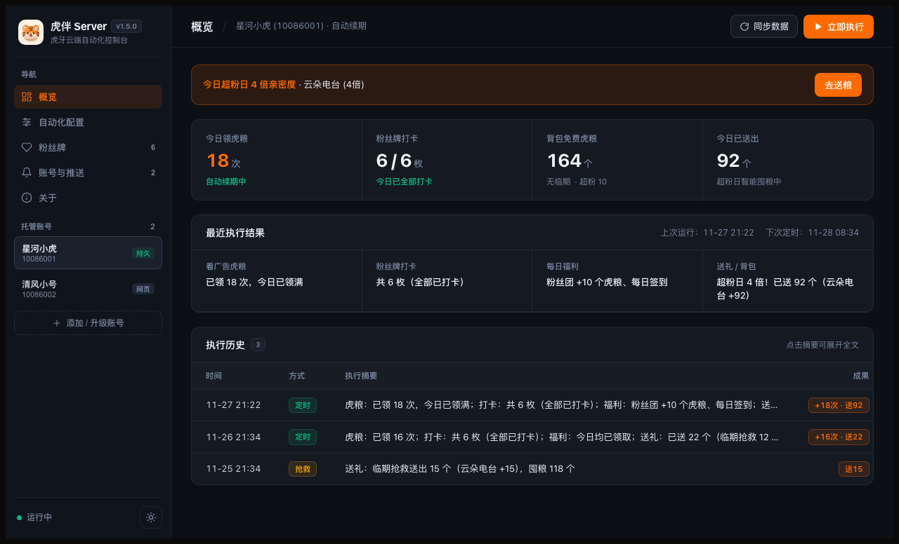
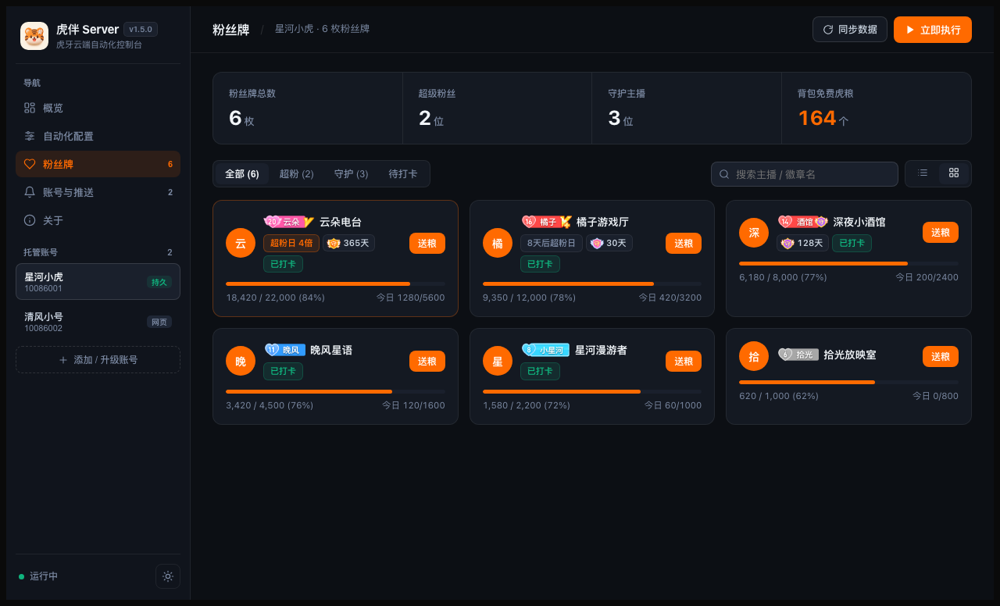
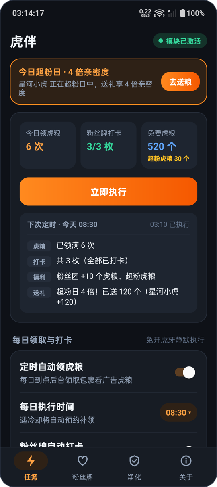
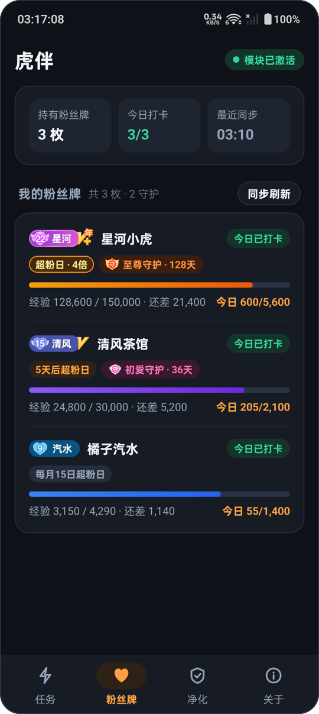
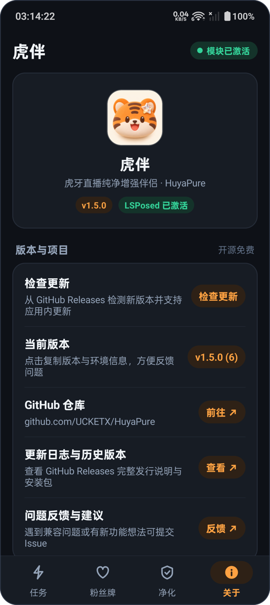

<div align="center">

<picture>
  <source media="(prefers-color-scheme: dark)" srcset="assets/logo-dark.png" />
  <source media="(prefers-color-scheme: light)" srcset="assets/logo.png" />
  
</picture>

<h1>虎伴 · HuyaPure</h1>

<p><strong>虎牙直播自动化与纯净增强伴侣 · 全平台支持</strong></p>
<p>Android / iOS 移动端 App · 纯 Go 云端网页版 · Android LSPosed 模块版</p>

<p>
  <a href="https://github.com/UCKETX/HuyaPure/releases/latest">
    
  </a>
  <a href="LICENSE">
    
  </a>
  <a href="mobile-android/">
    
  </a>
  <a href="server/">
    
  </a>
  <a href="app/build.gradle.kts">
    
  </a>
</p>

<p>
  <a href="#-版本对比">版本对比</a> ·
  <a href="#-界面预览">界面预览</a> ·
  <a href="#-核心功能">核心功能</a> ·
  <a href="#-超粉日智能囤粮与分配策略">智能调度</a> ·
  <a href="#-快速开始">快速开始</a> ·
  <a href="#-兼容性说明">兼容性</a> ·
  <a href="#-实现原理">实现原理</a> ·
  <a href="CHANGELOG.md">更新日志</a>
</p>

</div>

---

## 🧭 版本对比

虎伴提供 **Android / iOS 移动端 App**、**云端网页版（虎伴 Server）** 与 **Android LSPosed 模块版** 三种形态，按你的设备环境任选其一或配合使用：

| 对比项 | 📲 Android / iOS App（[Android](mobile-android/) · [iOS](mobile-ios/)） | 🌐 云端网页版（[虎伴 Server](server/)） | 📱 Android LSPosed 模块版 |
| :--- | :---: | :---: | :---: |
| **适用环境** | 任意 Android / iOS 手机（开箱即用、免服务器） | 电脑 / NAS / VPS / Docker（24 小时在线） | 已安装 LSPosed 的 Android 手机 |
| **看广告领虎粮 · 打卡 · 福利 · 智能送礼** | ✅ 内置纯 Go 引擎本机运行 | ✅ 云端 24 小时定时执行 | ✅ 免开虎牙后台静默执行 |
| **多账号独立托管（5 种登录方式）** | ✅ 单 App 托管多账号 | ✅ 单实例托管多账号 | ❌ 跟随本机虎牙当前账号 |
| **主播头像 · 真实粉丝牌 · 三级原生守护** | ✅ 原生渲染 | ✅ 网页高清渲染 | ✅ 原生渲染 |
| **后台定时方式（默认 `01:00`）** | Android 精确闹钟 / iOS 快捷指令自动化 | 云端常驻调度器（最稳） | Android 闹钟 + Root 兜底 |
| **消息推送提醒** | ✅ 本地系统通知 + 6 种外部推送 | ✅ Bark / TG / Server酱 / 钉钉 / 飞书 / Webhook | ✅ 本地系统通知 |
| **浅色 / 深色双主题 & 自适应暗色 Logo** | ✅ 自动跟随设备切换主题与桌面/应用内图标 | ✅ 跟随系统自动切换主题、Logo 与 Favicon | ✅ 自动跟随设备切换主题与桌面/应用内图标 |
| **自动检查更新** | ✅ Android 应用内下载安装 · iOS 一键下载 IPA | Docker / 单文件更新 | ✅ 应用内下载安装（与移动版包自动隔离） |
| **去开屏与直播间广告 · 激励跳广告** | ❌ 仅模块版支持 | ❌ 仅模块版支持 | ✅ 客户端本地拦截 |
| **彻底禁用 P2P / MiniPCDN 上传** | ❌ 仅模块版支持 | ❌ 仅模块版支持 | ✅ 强制纯 HTTP-FLV 播放 |

---

## 📸 界面预览

### 🌐 云端网页版（虎伴 Server）

<div align="center">
  <table>
    <tr>
      <td align="center" width="50%">
        <br />
        <sub><b>概览 · 超粉日提醒、多账号管理与执行历史</b></sub>
      </td>
      <td align="center" width="50%">
        <br />
        <sub><b>粉丝牌 · 官方高清徽章、原生守护与手动送粮</b></sub>
      </td>
    </tr>
  </table>
  <p><sub>截图内容均为演示数据，支持桌面端与手机端自适应布局及浅色 / 深色双主题。</sub></p>
</div>

### 📱 Android 模块版

<div align="center">
  <table>
    <tr>
      <td align="center" width="25%">
        <br />
        <sub><b>任务总览 · 超粉日提醒</b></sub>
      </td>
      <td align="center" width="25%">
        <br />
        <sub><b>粉丝牌 · 守护与手动送粮</b></sub>
      </td>
      <td align="center" width="25%">
        <br />
        <sub><b>广告净化 · 禁用 P2P</b></sub>
      </td>
      <td align="center" width="25%">
        <br />
        <sub><b>关于 · 应用内更新</b></sub>
      </td>
    </tr>
  </table>
  <p><sub>截图内容均为演示数据，界面支持跟随系统自动切换浅色 / 深色主题。</sub></p>
</div>

---

## ✨ 核心功能

### ⚡ 每日自动化任务（全版本共用）
- **包裹看广告领虎粮**：自动激活展位并兼容普通奖励与 `awardCommRewardTask` 通道，领满当日全部看广告虎粮，遇冷却自动预约补领。
- **全粉丝牌自动打卡**：遍历账号下所有粉丝牌完成每日亲密度打卡，同步刷新时完整保留当日已打卡状态。
- **每日专属福利全收**：自动领取粉丝团每日 `10` 个虎粮、超粉虎粮、通用福利与每日签到。
- **超粉虎粮独立优先送**：精准识别房间作用域内的 1 天有效期超粉虎粮，优先送给超粉主播不浪费。
- **安全锁定免费通道**：严格仅扣免费包裹道具，**绝不消耗金豆与虎牙币**；默认每日 `01:00` 定时执行，每账号最多保留最近 30 条执行记录防膨胀。

### ❤️ 原汁原味粉丝牌、守护与手动送粮（全版本共用）
- **主播头像 & 官方真实粉丝牌**：全版本统一卡片布局，展示主播圆形头像、虎牙原生/主播**定制粉丝牌**、超粉（`V` / `V年` / `V+`）及**三级原生守护盾徽**（初爱 / 超级 / 至尊守护）。
- **超粉日实时识别**：自动拉取每位主播的超粉日日期、倒计时与 **4 倍亲密度**倍率，当日联动提醒。
- **统一底部送礼面板**：点击任意粉丝牌即可弹出统一详情与手动送粮面板，支持一键复制 UID、切换普通/超粉虎粮与快捷数量赠送。

### 📲 移动端原生体验（Android & iOS App）
- **纯原生零依赖界面**：Android 采用纯 SDK 原生 UI（上下滑动滚轮定时选择器、点击卡片即切账号、流畅动效）；iOS 采用纯 SwiftUI（适配 iOS 26/27 原生 **Liquid Glass 液态玻璃**标签栏与底部选项面板）。
- **全版本暗色模式自适应 Logo**：内置暖夜星光暗色版图标，自动读取系统深浅色切换界面主题、应用内 Logo 与桌面图标（iOS 原生 `luminosity: dark` 暗色图标，Android 双启动别名退至后台静默刷新）。
- **内置自动检查更新**：定期静默检测 GitHub Releases 新版本并在顶栏与「设置」页提示；Android 支持应用内进度条下载并一键安装，iOS 支持一键跳转下载最新 IPA。

### 🌐 云端网页版专属能力（虎伴 Server）
- **极简部署**：纯 Go 零外部依赖单二进制 + 嵌入式 Web 控制台，Docker 镜像约 15 MB，支持环境变量 `HUBAN_PASSWORD` 开启密码保护。
- **多账号与 5 种登录**：支持手机短信、微信扫码、QQ 扫码、虎牙扫码与 Cookie 导入，登录后自动读取真实虎牙昵称与头像。
- **桌面 & 手机双端优化**：手机浏览器自动启用底部导航栏与卡片式列表，自动跟随系统 `prefers-color-scheme` 切换深浅主题、Logo 与浏览器 Favicon。
- **6 大消息推送**：内置 **Bark（iOS 推荐）**、Telegram、Server酱、钉钉、飞书与自定义 Webhook。

### 🛡️ 全域去广告 & 彻底禁 P2P（Android 模块版专属）
- **激励视频跳广告领奖**：覆盖穿山甲（CSJ）、优量汇（AMS）与虎牙自建（KA）三渠道，免看直接发奖。
- **屏蔽开屏与直播间广告**：拦截冷/热启动开屏、浮窗、角标、商业风车与推广弹幕，不影响领虎粮。
- **消除后台 P2P 偷跑上传**：彻底关闭 MiniPCDN、FileP2P 做种与直播间 P2P/IPv6 打洞，强制纯 HTTP-FLV 播放（实测出站 UDP 归零）。
- **适配热更新 & 应用内更新**：自动监听 Tinker / Qigsaw 热补丁切换 ClassLoader；内置 GitHub Releases 检查更新与下载安装，且严格过滤模块版 APK 与移动版互不干扰。

---

## 🎯 超粉日智能囤粮与分配策略

> [!TIP]
> **免费虎粮不浪费，超粉日 4 倍亲密度吃满！**
> 虎伴会解析背包内**每一批次免费虎粮的精确到期时间**，结合每位主播的超粉日配置自动决策：

| 场景 | 自动调度行为 |
| :--- | :--- |
| **🎉 今天就是超粉日** | 立刻将包裹内可用免费虎粮（含超粉虎粮与囤积的普通虎粮）集中送给当日超粉日主播，吃满 **4 倍亲密度与 4 倍上限**。 |
| **📦 非超粉日 · 临期批次（≤ 36h）** | 提前送出 1 天有效期超粉虎粮与 36 小时内即将过期的普通批次（利用虎牙先到期先扣规则），且**临期批次自动突破单次赠送上限**，杜绝过期浪费。 |
| **⏳ 非超粉日 · 长效批次** | 有效期能撑过下次超粉日的免费虎粮**原地囤在背包**，静候超粉日当天集中爆发。 |
| **⏰ 临期抢救闹钟** | 若同步后发现有虎粮会在下次每日定时之前过期，自动在**到期前 30 分钟**额外预约一次后台抢救任务。 |

### 多选目标与 4 种分配方式

支持在「赠送目标」中任意多选主播（快捷支持 `全选` / `仅超粉` / `清空` / `+ 自定义 UID`），并在选择多位主播时切换 4 种分配策略：

| 分配方式 | 适用场景与逻辑 |
| :--- | :--- |
| **平均分配** | 将本次赠送的虎粮均匀分配给选中的每位主播。 |
| **优先补满今日亲密度上限** `推荐` | 按顺序结合超粉/超粉日倍率计算当日剩余亲密度配额，先喂满前序主播，溢出自动顺延下一位，避免亲密度浪费。 |
| **优先送离升级最近的主播** | 按粉丝牌升级所需剩余经验由少到多排序，优先集中助力最快升牌的主播。 |
| **按自定义比例分配** | 在多选弹窗中直接微调每位主播的权重份数，采用最大余数法精确拆分。 |

---

## 🚀 快速开始

### 📲 方式一：Android / iOS 移动端 App（开箱即用 · 免服务器）

内置纯 Go 核心引擎，纯原生界面（Android 原生 / iOS SwiftUI），支持 5 种登录方式、多账号独立托管、内置自动更新与系统深浅色自适应图标（登录能力见下方登录方式对比表）：

- **Android App**：前往 [**GitHub Releases**](https://github.com/UCKETX/HuyaPure/releases/latest) 下载 `HuyaPure-vX.X.X-android.apk` 安装（包名 `com.huya.pure.mobile`，可与 LSPosed 模块版共存）。建议在「设置」页授予通知权限并将应用加入电池优化白名单，以保障每日后台定时稳定触发。
- **iOS App**：前往 [**GitHub Releases**](https://github.com/UCKETX/HuyaPure/releases/latest) 下载 `HuyaPure-vX.X.X-ios-unsigned.ipa`，通过 **TrollStore（巨魔）/ SideStore / AltStore / Sideloadly** 安装。App 内置快捷指令动作 **「执行虎伴每日任务」**，可在系统「快捷指令 → 自动化 → 特定时间」中配置每日自动执行并接收系统通知。

---

### 🌐 方式二：云端网页版（虎伴 Server · 24 小时挂机）

#### Docker Compose（推荐 · 无需克隆源码）
前往 [**GitHub Releases**](https://github.com/UCKETX/HuyaPure/releases/latest) 下载 `docker-compose.yml`，或直接运行：
```bash
curl -fsSLO https://github.com/UCKETX/HuyaPure/releases/latest/download/docker-compose.yml
docker compose up -d
```

#### 预编译单文件（Linux / macOS / Windows · amd64 & arm64）
前往 [**GitHub Releases**](https://github.com/UCKETX/HuyaPure/releases/latest) 下载对应平台的 `HuyaPure-server-vX.X.X-<os>-<arch>.tar.gz`（Windows 为 `.zip`），解压后直接启动：
```bash
# Linux / macOS
./HuyaPure-server -addr :8686 -data ./data

# Windows (PowerShell)
.\HuyaPure-server.exe -addr :8686 -data .\data
```

启动后浏览器访问 `http://localhost:8686` 即可添加账号与配置定时任务。公网部署时强烈建议设置 `HUBAN_PASSWORD` 启用访问密码保护。

#### 环境变量

| 变量 | 默认值 | 说明 |
| :--- | :--- | :--- |
| `HUBAN_ADDR` | `:8686` | HTTP 监听地址 |
| `HUBAN_DATA_DIR` | `./data` | 持久化数据目录（存储 `state.json`） |
| `HUBAN_PASSWORD` | 空（不设密码） | Web 面板与 API 访问密码 |
| `TZ` | `Asia/Shanghai` | 定时任务时区 |

#### 登录方式对比

| 登录方式 | 看广告领虎粮 | 粉丝牌打卡 | 每日福利 | 自动/手动送粮 | 自动续期（不掉线） | 免绑手机号 |
| :--- | :---: | :---: | :---: | :---: | :---: | :---: |
| **手机短信** `推荐` | ✅ | ✅ | ✅ | ✅ | ✅ | ❌ |
| **微信扫码** | ✅ | ✅ | ✅ | ✅ | ❌ | ✅ |
| **QQ 扫码** | ✅ | ✅ | ✅ | ✅ | ❌ | ✅ |
| **虎牙扫码** | ✅ | ✅ | ✅ | ✅ | ❌ | ✅ |
| **Cookie 导入** | ✅ | ✅ | ✅ | ✅ | ❌ | ✅ |

> **小提示**：同一账号若已通过「手机短信」开启自动续期，后续即使误用扫码或 Cookie 登录同一账号，也会自动保留长期登录状态不会被降级覆盖。

---

### 📱 方式三：Android LSPosed 模块版

1. 前往 [**GitHub Releases**](https://github.com/UCKETX/HuyaPure/releases/latest) 下载最新版 `HuyaPure-vX.X.X-lsposed.apk` 并安装（包名 `com.huya.pure`，桌面显示名 **虎伴**）。
2. 打开 **LSPosed Manager → 模块 → 虎伴**：
   - 开启模块总开关；
   - 勾选作用域 **虎牙直播（`com.duowan.kiwi`）**。
3. **强行停止**虎牙直播并重新打开使其加载模块（后续在虎伴「净化」页可一键重启虎牙）。
4. 打开 **虎伴** App：
   - 顶栏显示绿点 `模块已激活` 即表示就绪；
   - 在「任务」页按需开启定时领虎粮、自动打卡、每日福利与自动送免费虎粮；
   - 如国产系统限制后台唤醒，建议允许虎牙关联启动或授予「虎伴」Root 权限以启用无感兜底通道。

> [!NOTE]
> 自动送礼与手动送礼均严格通过虎牙包裹支付策略（`SendGiftPayPloyUtil.PACKAGE_PAY_PLOY`，`lPayCount == 0 && lNewCoinDeduction == 0`）执行，代码层面双重校验，绝不会扣减金豆或虎牙币。

---

## 📱 兼容性说明

| 项目 | 说明 |
| :--- | :--- |
| **Android App 要求** | Android 8.0+（API 26+），无需额外框架与服务器（支持 `arm64-v8a` / `armeabi-v7a` / `x86_64`） |
| **iOS App 要求** | iOS 16.0+（iOS 26/27 自动启用原生 Liquid Glass 液态玻璃标签栏与暗色图标），通过 TrollStore / SideStore / AltStore / 自签工具安装 |
| **云端网页版要求** | Docker 或 Go 1.24+（支持 Linux / macOS / Windows，x86_64 & ARM64） |
| **Android 模块版要求** | Android 8.0+（API 26+），已安装 LSPosed（推荐 Zygisk / JingMatrix LSPosed） |
| **目标客户端** | 虎牙直播国内正式版（`com.duowan.kiwi`），实机验证 `13.5.62`（含 Tinker 热补丁）/ Android 16 |
| **其他版本说明** | 未硬编码版本号，核心 Hook 点与 WUP 协议结构体通用，相近 `13.x` 版本通常可直接兼容；不支持极速版、TV/HD 版与国际版 |

---

## 🔧 实现原理

<details>
<summary><strong>点击展开查看核心 Hook 点与 WUP 协议细节</strong></summary>

模块入口位于 [`HookEntry.java`](app/src/main/java/com/huya/pure/HookEntry.java)，云端纯 Go 协议实现位于 [`server/internal/huya/`](server/internal/huya/)，主要包含以下子系统：

#### 1. 无界面后台任务引擎（`AutoClaimEngine` / `server/internal/huya`）
- Android 端 Hook `InnerAuthLoginProvider.call()` 响应无界面 Binder 指令，支持自动任务（`huya_pure_auto_claim_v1`）与单主播手动送粮（`huya_pure_manual_send_v1`）；云端版由纯 Go 直接实现 JCE / UniPacket v3 编解码与 WUP RPC。
- 依次调用虎牙原生 WUP 服务：`getPropsListPlacement` / `notifyPropsListPlacement` + `getCommAdPannel` + `awardCommAdTask`（领看广告虎粮）、`liveui.queryBadgeInfoList` + `wupui.setFansSign`（全粉丝牌打卡）、`wupui.queryFansGroupTaskInfo` + `wupui.operateFansBox` + `wupui.receiveCommonWelfare`（每日福利与签到）、`wupui.getLiveRoomProfileForAudience`（查询 `SuperFansConfig` 超粉日）、`wupui.getPackageGift`（传入超粉主播 PID 解析普通与超粉免费虎粮批次）以及 `wupui.sendGift`（锁定包裹免费送礼）。
- 粉丝牌与守护图标通过 `wupui.getCustomBadgeBaseInfo`（云端）与 `NativeBadgeRenderer`（Android）动态加载虎牙官方资源，**项目内不打包任何第三方版权素材**。

#### 2. 激励视频跳过并领奖（Android）
- **穿山甲（CSJ / Pangle）**：Hook `HyAdManagerInner.loadPangleRewardAd` / `loadPangleRewardShopMallAd`，跳过广告展示并完整触发 `onShowRewardVideo` → `onAdPlay` → `onVideoRewardVerify(true)` → `onAdClose`。
- **优量汇（AMS / GDT）**：Hook `HyAdManagerInner.loadAmsRewardAd`，保留真实 `passThroughData` 元数据，跳过 `TangramRewardAD.showAD()` 并触发发奖回调。
- **虎牙自建（KA）**：Hook `VideoAdPlayFragmentDialog.showAd`，隐藏视频容器并自动完成领奖与关闭。

#### 3. 屏蔽开屏与直播间广告（Android）
- **开屏广告**：Hook `AdRouter`、`SplashShowStrategy`、`HyAdSplashManager`、`AdSplashModule`，并以 `AdSplashFragment` 跳转首页作为兜底。
- **直播间广告**：开启 `HyAdModule.isNeedShieldAdInLivingRoom`，拦截 `RevenueModule`、`PresenterAdModule`、`AdxModule`、`RewardAdModule`、`AdBannerModule` 与 `LiveRoomFloatSuperAd`（与激励领虎粮通道严格隔离）。

#### 4. 彻底关闭后台及直播间 P2P / MiniPCDN / FileP2P 上传（Android）
- **热更新适配**：监听 `Application.attach`、`attachBaseContext` 与 `Instrumentation.callApplicationOnCreate`，在 Tinker / Qigsaw 切换 `SplitDelegateClassloader` 后自动重装全部 Hook。
- **`SignalClient` 动态配置清洗**：通过 `nativeOnParamsConfigResult` 覆写 110+ 项 P2P / MiniPCDN（MPS / H3Server / WebRTCServer）/ FileP2P / HeatList / IPv6 打洞 / mDNS 开关，并拦截 `/mediaui/getMediaConfig` 防止服务端覆盖。
- **强制纯 HTTP-FLV 拉流**：拦截 `HYStreamConfig`、`HYLiveStreamConfig`、`HYLivePlayerImp`、`HyStreamMessageGenerator`、`ChannelSession`、`CDNLine`、`MultiLineConfig`、`ABSLine`、`P2PMonitor`、`CloudSdkDynamicConfigModule`，将 `P2P_STREAM` / `TX_XP2P_STREAM` 强制转为 `FLV_STREAM`，关闭弹幕 P2P 中继并保留正常 WebSocket 弹幕。

</details>

---

## 🛠️ 从源码编译

### Android App
需要 **Go 1.24+**、**JDK 17+** 与 **Android SDK**（无需 Android NDK）：
```bash
# 1. 编译三架构纯 Go 引擎到 mobile-android/src/main/jniLibs/
./scripts/build-android-core.sh

# 2. 编译 APK
./gradlew :mobile-android:assembleDebug :mobile-android:assembleRelease
```

### iOS App（SwiftUI）
需要 **macOS + Xcode 16+** 与 **Go 1.24+**：
```bash
# 1. 编译 Go 静态库并封装为 mobile-ios/Frameworks/HubanCore.xcframework
./scripts/build-ios-xcframework.sh

# 2. 打包无签名 Release IPA（输出到 mobile-ios/build/）
./scripts/build-ios-ipa.sh v1.7.0
```

### Android 模块版
需要 **JDK 17+** 与 **Android SDK**（默认 `compileSdk = 37`、`buildToolsVersion = 36.0.0`，可在 [`app/build.gradle.kts`](app/build.gradle.kts) 按需调整）：
```bash
# 编译 Debug / Release APK
./gradlew :app:assembleDebug :app:assembleRelease

# 安装到已连接的 Android 设备
adb install -r app/build/outputs/apk/debug/app-debug.apk
```

### 云端网页版（虎伴 Server）
需要 **Go 1.24+**（零外部依赖）：
```bash
cd server

# 编译并运行
go build -trimpath -ldflags="-s -w" -o HuyaPure-server ./cmd/huban-server
./HuyaPure-server -addr :8686 -data ./data

# 或从本地源码构建 Docker 镜像
docker compose up -d

# 运行单元测试（加上 HUBAN_LIVE_TEST=1 可额外验证虎牙实时连通性）
go test -v ./...
```

---

## 📝 更新日志

完整版本变更记录请查看 [**CHANGELOG.md**](CHANGELOG.md)。

---

## ⚠️ 免责声明 & 开源协议

- 本项目仅供技术学习、网络协议研究与个人体验优化使用；请勿用于任何商业用途、违法违规场景或恶意刷量行为，使用者需自行承担一切风险与后果。
- 本项目基于 [**GNU General Public License v3.0 (GPL-3.0)**](LICENSE) 开源。
