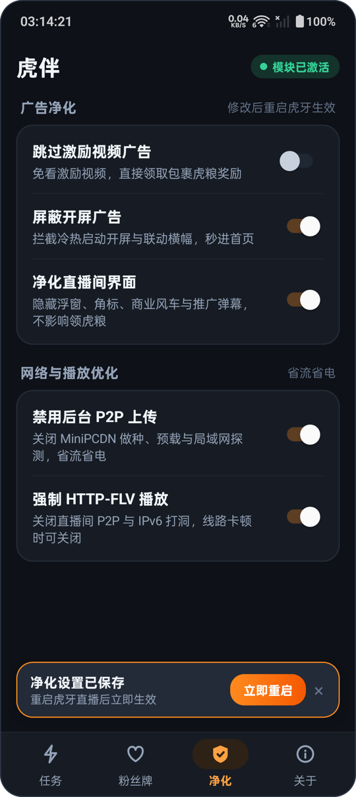

<div align="center">


<h1>虎伴 · HuyaPure</h1>

<p><strong>虎牙直播纯净增强伴侣（LSPosed / Xposed 模块）</strong></p>
<p>免开虎牙自动领虎粮与打卡 · 超粉日 4 倍亲密度智能囤粮 · 全域去广告与彻底禁用 P2P 上传</p>

<p>
  <a href="https://github.com/UCKETX/HuyaPure/releases/latest">
    
  </a>
  <a href="LICENSE">
    
  </a>
  <a href="app/build.gradle.kts">
    
  </a>
  <a href="app/src/main/AndroidManifest.xml">
    
  </a>
  <a href="app/src/main/res/values/arrays.xml">
    
  </a>
</p>

<p>
  <a href="#-界面预览">界面预览</a> ·
  <a href="#-核心功能">核心功能</a> ·
  <a href="#-超粉日智能囤粮与分配策略">智能调度</a> ·
  <a href="#-安装与使用">安装使用</a> ·
  <a href="#-兼容性说明">兼容性</a> ·
  <a href="#-实现原理">实现原理</a> ·
  <a href="CHANGELOG.md">更新日志</a>
</p>

</div>

---

## 📸 界面预览

<div align="center">
  <table>
    <tr>
      <td align="center" width="25%">
        <br />
        <sub><b>任务总览 · 超粉日提醒</b></sub>
      </td>
      <td align="center" width="25%">
        <br />
        <sub><b>粉丝牌 · 守护与手动送粮</b></sub>
      </td>
      <td align="center" width="25%">
        <br />
        <sub><b>广告净化 · 禁用 P2P</b></sub>
      </td>
      <td align="center" width="25%">
        <br />
        <sub><b>关于 · 应用内更新</b></sub>
      </td>
    </tr>
  </table>
  <p><sub>截图内容均为演示数据，界面支持跟随系统自动切换浅色 / 深色主题。</sub></p>
</div>

---

## ✨ 核心功能

### ⚡ 每日自动化任务（免开虎牙）
- **无界面静默唤醒**：通过 `ContentProvider.call()` 复用虎牙登录态，无需打开客户端界面。
- **包裹看广告领虎粮**：每日定时领满当日全部看广告虎粮，遇冷却自动预约补领。
- **全粉丝牌自动打卡**：遍历账号下所有粉丝牌完成每日亲密度打卡。
- **每日专属福利全收**：自动领取粉丝团每日 `10` 个虎粮、超粉/超级虎粮、通用福利、每日签到与任务宝箱。

### ❤️ 粉丝牌、守护与手动送粮
- **原汁原味粉丝牌**：动态还原虎牙原生与主播**定制粉丝牌**，支持 `初爱 / 超级 / 至尊守护` 与纯图标超粉标识。
- **超粉日实时识别**：自动拉取每位主播的超粉日日期、倒计时与 **4 倍亲密度**倍率，当日弹窗/横幅/通知联动提醒。
- **点击主播手动送粮**：轻点粉丝牌即可查看详情、复制 UID，或直接手动赠送**免费虎粮 / 超粉虎粮**。
- **安全锁定免费通道**：严格仅扣 `iIsPay=0` 包裹免费道具，**绝不消耗金豆与虎牙币**。

### 🛡️ 全域去广告 & 彻底禁 P2P
- **激励视频跳广告领奖**：覆盖穿山甲（CSJ）、优量汇（AMS）与虎牙自建（KA）三渠道，免看直接发奖。
- **屏蔽开屏与直播间广告**：拦截冷/热启动开屏、浮窗、角标、商业风车与推广弹幕，不影响领虎粮。
- **消除后台 P2P 偷跑上传**：彻底关闭 MiniPCDN、FileP2P 做种与直播间 P2P/IPv6 打洞，强制纯 HTTP-FLV 播放（实测出站 UDP 归零）。
- **适配热更新**：自动监听 Tinker / Qigsaw 热补丁切换 ClassLoader，避免更新后失效。

### 🎨 现代化四页签 UI & 全自绘交互
- **四页签清晰分层**：`任务` / `粉丝牌` / `净化` / `关于`，支持空心→实心动态切换图标、丝滑过渡与浅色/深色双主题。
- **全套自绘弹窗与菜单**：自绘底部时间选择器、多选目标与比例权重面板、居中模态框与下载进度条，告别原生弹窗割裂感。
- **差值感知悬浮重启条**：「净化」页修改开关且存在净变动时浮出重启条，支持 Root 一键静默重启虎牙。
- **应用内检查更新**：对接 GitHub Releases，支持应用内查看日志、带进度条下载 APK 并直接安装。

---

## 🎯 超粉日智能囤粮与分配策略

> [!TIP]
> **免费虎粮不浪费，超粉日 4 倍亲密度吃满！**
> 虎伴会解析背包内**每一批次免费虎粮的精确到期时间戳**（`UserPackageItemInfo.lExpireTime`），结合每位主播的 `SuperFansConfig` 超粉日配置自动决策：

| 场景 | 自动调度行为 |
| :--- | :--- |
| **🎉 今天就是超粉日** | 立刻将包裹内可用免费虎粮（含超粉虎粮与囤积的普通虎粮）集中送给当日超粉日主播，吃满 **4 倍亲密度与 4 倍上限**。 |
| **📦 非超粉日 · 临期批次（≤ 36h）** | 提前送出 1 天有效期超粉虎粮与 36 小时内即将过期的普通批次（利用虎牙 FIFO 先到期先扣规则），且**临期批次自动突破单次赠送上限**，杜绝过期浪费。 |
| **⏳ 非超粉日 · 长效批次** | 有效期能撑过下次超粉日的免费虎粮**原地囤在背包**，静候超粉日当天集中爆发。 |
| **⏰ 临期抢救闹钟** | 若同步后发现有虎粮会在下次每日定时之前过期，自动在**到期前 30 分钟**额外预约一次后台抢救唤醒（`ACTION_EXPIRY_RESCUE_ALARM`）。 |

### 多选目标与 4 种分配方式

支持在「自动送免费虎粮 → **赠送目标**」中任意多选主播（快捷支持 `全选` / `仅超粉` / `清空` / `+ 自定义 UID`），并在选择多位主播时切换 4 种分配策略：

| 分配方式 | 适用场景与逻辑 |
| :--- | :--- |
| **平均分配** | 将本次赠送的虎粮均匀分配给选中的每位主播。 |
| **优先补满今日亲密度上限** `推荐` | 按顺序结合超粉/超粉日倍率计算当日剩余亲密度配额，先喂满前序主播，溢出自动顺延下一位，避免亲密度浪费。 |
| **优先送离升级最近的主播** | 按粉丝牌升级所需剩余经验由少到多排序，优先集中助力最快升牌的主播。 |
| **按自定义比例分配** | 在多选弹窗中直接微调每位主播的权重份数（实时预览百分比），采用最大余数法精确拆分。 |

---

## 🚀 安装与使用

1. 前往 [**GitHub Releases**](https://github.com/UCKETX/HuyaPure/releases/latest) 下载最新版 `HuyaPure-vX.X.X-release.apk` 并安装（包名 `com.huya.pure`，桌面显示名 **虎伴**）。
2. 打开 **LSPosed Manager → 模块 → 虎伴**：
   - 开启模块总开关；
   - 勾选作用域 **虎牙直播（`com.duowan.kiwi`）**。
3. **强行停止**虎牙直播并重新打开使其加载模块（后续在虎伴「净化」页可一键重启虎牙）。
4. 打开 **虎伴** App：
   - 顶栏显示绿点 `模块已激活` 即表示就绪；
   - 在「任务」页按需开启定时领虎粮、自动打卡、每日福利与自动送免费虎粮；
   - 如国产系统限制后台唤醒，建议允许虎牙关联启动或授予「虎伴」Root 权限以启用无感兜底通道。

> [!NOTE]
> 自动送礼与手动送礼均严格通过虎牙包裹支付策略（`SendGiftPayPloyUtil.PACKAGE_PAY_PLOY`，`lPayCount == 0 && lNewCoinDeduction == 0`）执行，代码层面双重校验，绝不会扣减金豆或虎牙币。

---

## 📱 兼容性说明

| 项目 | 说明 |
| :--- | :--- |
| **系统要求** | Android 8.0+（API 26+），已安装 LSPosed（推荐 Zygisk / JingMatrix LSPosed） |
| **目标应用** | 虎牙直播国内正式版（`com.duowan.kiwi`） |
| **实机验证版本** | 虎牙 `13.5.62`（含 Tinker 热更新补丁） / Android 16 |
| **其他版本说明** | 未硬编码版本号，核心 Hook 点与 WUP 协议结构体通用，相近 `13.x` 版本通常可直接兼容；不支持极速版、TV/HD 版与国际版 |

---

## 🔧 实现原理

<details>
<summary><strong>点击展开查看核心 Hook 点与 WUP 协议细节</strong></summary>

模块入口位于 [`HookEntry.java`](app/src/main/java/com/huya/pure/HookEntry.java)，主要包含以下子系统：

#### 1. 无界面后台任务引擎（`AutoClaimEngine` / `RawWupClient`）
- Hook `InnerAuthLoginProvider.call()` 响应无界面 Binder 指令，支持自动任务（`huya_pure_auto_claim_v1`）与单主播手动送粮（`huya_pure_manual_send_v1`）。
- 依次调用虎牙原生 WUP / 协程服务：`GetCommAdPannel` + `HyLotteryAdAwardManager.onAwardCommonAdTask`（领虎粮）、`liveui.queryBadgeInfoList` + `wupui.setFansSign`（全粉丝牌打卡）、`wupui.queryFansGroupTaskInfo` + `wupui.operateFansBox` + `wupui.queryFGCommonWelfare` + `OldUserBackSign` + `GetLiveBoxPage/AwardLiveBox`（每日福利与签到）、`wupui.getLiveRoomProfileForAudience`（查询 `SuperFansConfig` 超粉日）、`wupui.getPackageGift`（解析免费虎粮批次与 `lExpireTime`）以及 `SendGiftService.executeSingleSend`（包裹免费送礼）。
- 通过 `NativeBadgeRenderer` 动态读取虎牙本地 `.commonbadge` / `.privilege/guard` 资源与定制粉丝牌远程图层，**APK 内不打包任何第三方版权素材**。

#### 2. 激励视频跳过并领奖
- **穿山甲（CSJ / Pangle）**：Hook `HyAdManagerInner.loadPangleRewardAd` / `loadPangleRewardShopMallAd`，跳过广告展示并完整触发 `onShowRewardVideo` → `onAdPlay` → `onVideoRewardVerify(true)` → `onAdClose`。
- **优量汇（AMS / GDT）**：Hook `HyAdManagerInner.loadAmsRewardAd`，保留真实 `passThroughData` 元数据，跳过 `TangramRewardAD.showAD()` 并触发发奖回调。
- **虎牙自建（KA）**：Hook `VideoAdPlayFragmentDialog.showAd`，隐藏视频容器并自动完成领奖与关闭。

#### 3. 屏蔽开屏与直播间广告
- **开屏广告**：Hook `AdRouter`、`SplashShowStrategy`、`HyAdSplashManager`、`AdSplashModule`，并以 `AdSplashFragment` 跳转首页作为兜底。
- **直播间广告**：开启 `HyAdModule.isNeedShieldAdInLivingRoom`，拦截 `RevenueModule`、`PresenterAdModule`、`AdxModule`、`RewardAdModule`、`AdBannerModule` 与 `LiveRoomFloatSuperAd`（与激励领虎粮通道严格隔离）。

#### 4. 彻底关闭后台及直播间 P2P / MiniPCDN / FileP2P 上传
- **热更新适配**：监听 `Application.attach`、`attachBaseContext` 与 `Instrumentation.callApplicationOnCreate`，在 Tinker / Qigsaw 切换 `SplitDelegateClassloader` 后自动重装全部 Hook。
- **`SignalClient` 动态配置清洗**：通过 `nativeOnParamsConfigResult` 覆写 110+ 项 P2P / MiniPCDN（MPS / H3Server / WebRTCServer）/ FileP2P / HeatList / IPv6 打洞 / mDNS 开关，并拦截 `/mediaui/getMediaConfig` 防止服务端覆盖。
- **强制纯 HTTP-FLV 拉流**：拦截 `HYStreamConfig`、`HYLiveStreamConfig`、`HYLivePlayerImp`、`HyStreamMessageGenerator`、`ChannelSession`、`CDNLine`、`MultiLineConfig`、`ABSLine`、`P2PMonitor`、`CloudSdkDynamicConfigModule`，将 `P2P_STREAM` / `TX_XP2P_STREAM` 强制转为 `FLV_STREAM`，关闭弹幕 P2P 中继并保留正常 WebSocket 弹幕。

</details>

---

## 🛠️ 从源码编译

### 环境要求
- **JDK 17+**
- **Android SDK**（默认 `compileSdk = 37`、`buildToolsVersion = 36.0.0`，可在 [`app/build.gradle.kts`](app/build.gradle.kts) 按需调整）

### 编译与安装
```bash
# 编译 Debug / Release APK
./gradlew assembleDebug assembleRelease

# 安装到已连接的 Android 设备
adb install -r app/build/outputs/apk/debug/app-debug.apk
```

---

## 📝 更新日志

完整版本变更记录请查看 [**CHANGELOG.md**](CHANGELOG.md)。

---

## ⚠️ 免责声明 & 开源协议

- 本项目仅供 Android 逆向技术学习、网络流量研究与个人体验优化使用；请勿用于任何商业用途、违法违规场景或恶意刷量行为，使用者需自行承担一切风险与后果。
- 本项目基于 [**GNU General Public License v3.0 (GPL-3.0)**](LICENSE) 开源。
